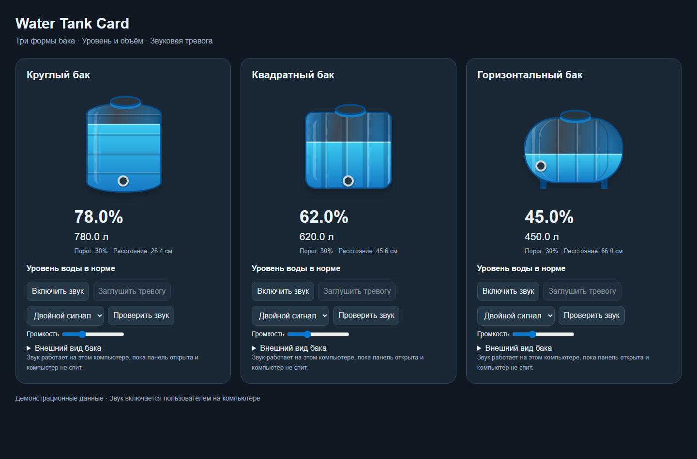
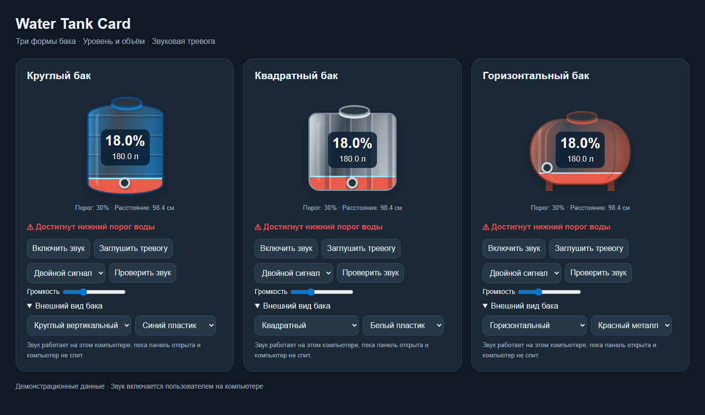
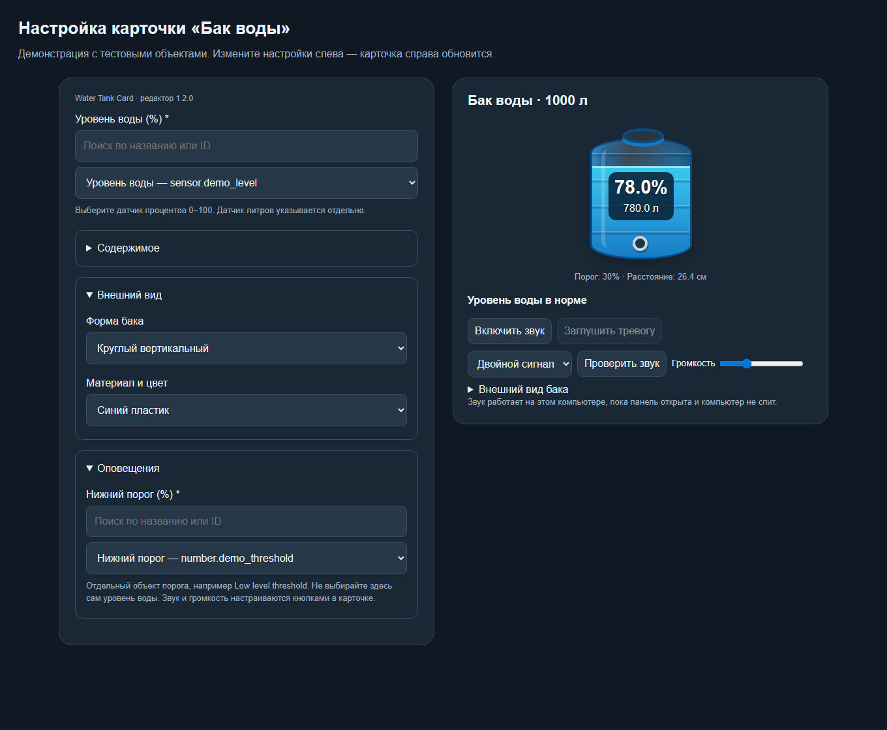

# Water_level_tank_card

Карточка уровня воды для Home Assistant: бак, проценты, литры и звуковое оповещение в браузере компьютера.

## Как выглядит карточка

Круглый, квадратный и горизонтальный бак с демонстрационными показаниями:



Низкий уровень воды: красная заливка и предупреждение. Здесь также показаны белый и металлический варианты бака и настройки внешнего вида.



Это снимки работающей карточки с тестовыми данными. Для просмотра демонстрации скачайте репозиторий и откройте `preview.html` в браузере. Звук можно проверить кнопкой в карточке.

Визуальные настройки и предпросмотр:



Это самостоятельная демонстрация редактора с тестовыми объектами: откройте `editor-preview.html` и измените поля слева. В Home Assistant используются его стандартные поля и списки объектов; если они ещё не загружены, доступна встроенная форма с поиском.

Текущая версия: **1.2.1**. В списке выбора карточек отображаются название **Water_level_tank_card** и предпросмотр бака. Номер установленной версии также показан в визуальном редакторе.

## Возможности

- Проценты и литры внутри бака на контрастной подложке.
- Визуальный редактор Home Assistant: выбор объектов, формы и цвета без YAML.
- Три формы: круглый вертикальный, квадратный, горизонтальный на опорах.
- Синий пластик, белый пластик и красный металл.
- Нижний порог из существующего объекта Home Assistant.
- Мигание при уровне ниже или равном порогу.
- Три звука: двойной сигнал, тройной сигнал, сирена; громкость и проверка звука.
- Повтор сигнала каждые 10 секунд и заглушение до восстановления уровня.

Карточка отображает данные существующих объектов. Интеграция MQTT и прошивка ESP8266 устанавливаются отдельно. Управление насосом в этой версии карточки не реализовано; существующие телефонные уведомления не изменяются.

## Установка через Marketplace

1. Откройте **Marketplace → Добавить по ссылке**.
2. Вставьте `https://github.com/gekso88/HAOS_Water-Tank-Card`.
3. Подключите GitHub, если Marketplace предложит это. Выберите тип **Панель / Dashboard**, если он запрашивается.
4. Установите карточку и обновите страницу браузера.
5. На панели выберите **Добавить карточку → Water_level_tank_card**. Выберите датчик уровня и нижнего порога в визуальном редакторе. В разделе **Содержимое** укажите датчики литров, расстояния и при необходимости достоверности; в **Внешний вид** выберите форму и цвет.

При обновлении уже установленной карточки загрузите свежую версию в Marketplace (через обновление или повторное скачивание) и перезагрузите страницу с очисткой кэша, например **Ctrl+F5**. После этого откройте редактирование карточки и нажмите **Форма ввода**, если пока отображается YAML. Вверху формы должна быть надпись **Water_level_tank_card · версия 1.2.1**.

Версия 1.2.0 содержит отдельный компонент редактора через [стандартный API `getConfigElement()`](https://contributors.home-assistant.io/frontend/custom-ui/card-editor/). Это исправляет сообщение «Визуальный редактор не поддерживается» в версиях Home Assistant, которые не открывали форму через один `getConfigForm()`. Пустая карточка теперь показывает подсказку настройки; выбирать датчики можно сразу в форме, без предварительного заполнения YAML.

Справа Home Assistant показывает предпросмотр. Настройки видимости и компоновки предоставляет сама панель Home Assistant; редактор сохраняет эти параметры при изменении полей.

Можно также добавить ручную карточку и вставить YAML:

Файл `hacs.json` является метаданными пакета для Marketplace; отдельная установка HACS не требуется.

```yaml
type: custom:water-tank-card
name: Бак воды · 1000 л
entity: sensor.tank_level
threshold_entity: number.tank_low_level_threshold
volume_entity: sensor.tank_volume
distance_entity: sensor.tank_distance
valid_entity: sensor.tank_measurement_valid
tank_shape: vertical
tank_color: blue
```

`entity` — обязательный процент заполнения 0–100. `threshold_entity` — обязательный числовой порог 0–100. Остальные объекты необязательны: литры, расстояние в сантиметрах, достоверность измерения (`True`, `on`, `1`). Не добавляйте `valid_entity`, если такого объекта нет.

В `threshold_entity` выбирайте отдельный объект **Low level threshold**, а не **Water level**. В `valid_entity` выбирайте **Measurement valid**, а не датчик расстояния или процентов. При недостоверном измерении вместо значений внутри бака появятся прочерки.

`tank_shape`: `vertical`, `square`, `horizontal`. `tank_color`: `blue`, `white`, `metal`.

Внешний вид можно переключить в самой карточке. Выбор сохраняется в этом браузере; явно заданные параметры YAML имеют приоритет при следующей загрузке.

Форма меняет только рисунок. Литры и проценты поступают от датчиков без пересчёта. Горизонтальный цилиндр требует нелинейного расчёта объёма на стороне датчика; картинка не исправляет расчёт прошивки. Заливка показывает условный процент заполнения.

## Звук на компьютере

Нажмите **Проверить звук**, выберите сигнал и громкость, затем **Включить звук**. При низком уровне сигнал начинается сразу. После открытия/перезагрузки страницы звук нужно включить снова: этого требуют ограничения браузеров.

Панель должна оставаться открытой, компьютер не должен спать. Закрытие карточки останавливает звук. Фоновые вкладки могут приостанавливаться браузером. Не включайте звук одновременно в нескольких копиях карточки, если не хотите слышать их одновременно. Это не отдельная служба Windows.

**Заглушить тревогу** выключает текущий сигнал до восстановления уровня выше порога. Красный значок остаётся. Неизвестное или недостоверное измерение не считается пустым баком.

## Ручная установка

Скопируйте `water-tank-card.js` в `/config/www/water-tank-card/` и зарегистрируйте ресурс `/local/water-tank-card/water-tank-card.js` с типом **JavaScript module**. Не регистрируйте одновременно ручную копию и копию Marketplace.

## Проверка

Для безопасной проверки создайте два вспомогательных числовых объекта 0–100: уровень и порог. Используйте их в отдельной карточке как `entity` и `threshold_entity`. При пороге 30 проверьте уровни 31 → 30 → 29 → 31: тревога начинается на 30 и прекращается на 31. Проверьте заглушение и повторное срабатывание после восстановления.

## Лицензия

MIT — см. [LICENSE](LICENSE).
